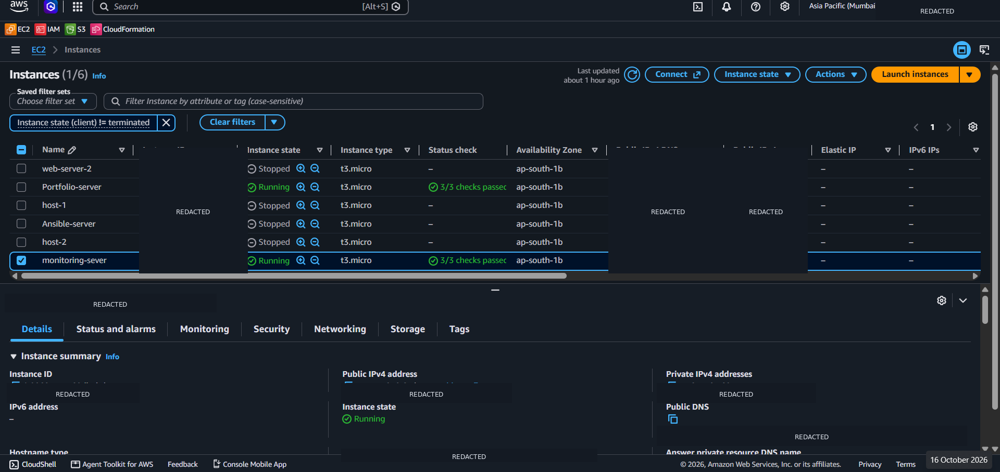
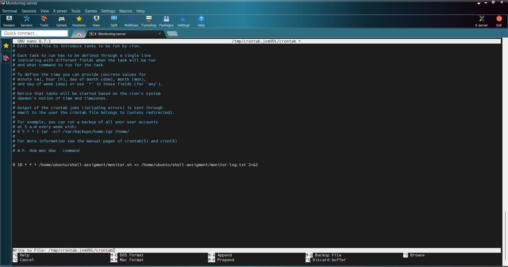
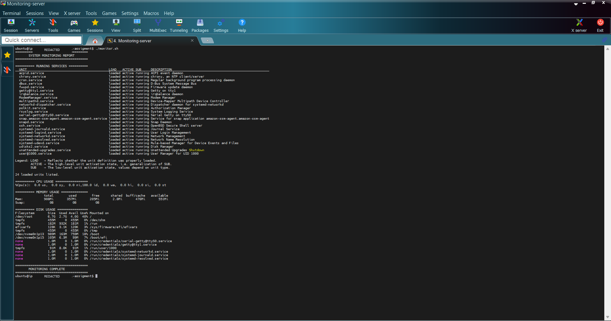

# EC2 System Monitoring using Bash

## 📌 Project Overview

This is a beginner-friendly project that demonstrates how to use **AWS EC2, Ubuntu Linux, Bash scripting, Cron, Git, and GitHub** to monitor a Linux server.

The project uses a Bash script named `monitor.sh` to display running services, CPU usage, memory usage, and disk usage. It also demonstrates how to save monitoring reports in a log file and schedule the script to run automatically using Cron.

## 🎯 Project Objectives

- Launch and connect to an AWS EC2 Ubuntu instance.
- Learn basic Linux commands and Bash scripting.
- Monitor running services and system resource usage.
- Save monitoring output to a log file.
- Schedule automated monitoring using Cron.
- Track and upload project changes using Git and GitHub.

## 🛠️ Technologies Used

| Technology | Purpose |
|---|---|
| AWS EC2 | Provides a cloud-based Linux server. |
| Ubuntu Linux | Operating system used on the EC2 instance. |
| Bash | Used to create the monitoring script. |
| Git | Tracks changes to project files. |
| GitHub | Hosts the project repository. |
| Cron | Schedules the script to run automatically. |

## 📂 Project Structure

```text
EC2-Monitoring/
├── monitor.sh
├── monitor-log.txt
├── crontab.txt
└── README.md
```

- `monitor.sh` — Displays system monitoring information.
- `monitor-log.txt` — Stores monitoring reports.
- `crontab.txt` — Optional documentation of the Cron schedule.
- `README.md` — Project documentation.

*Note: `crontab.txt` is optional. The actual schedule is configured separately using `crontab -e`.*

## 📋 Project Tasks

### Day 1: Environment Setup and Monitoring Script

**Task 1: Launch an EC2 Instance**

- Created an Ubuntu EC2 instance on AWS.
- Connected to the instance using SSH.

**Task 2: Install Required Tools**

Installed Git on Ubuntu.

```bash
sudo apt update
sudo apt install git -y
```

**Task 3: Initialize the Git Repository**

Created the project directory and initialized Git.

```bash
mkdir shell-assigment
cd shell-assigment
git init
```

**Task 4: Create the Monitoring Script**

Created `monitor.sh` to display:

- Current date and time.
- Running system services.
- CPU usage.
- Memory usage.
- Disk usage.

**Task 5: Push Code to GitHub**

Created the GitHub repository and uploaded the project files.

Repository: [Alpha1ne/EC2-Monitoring](https://github.com/Alpha1ne/EC2-Monitoring)

### Day 2: Automation and Logging

**Task 6: Log Monitoring Output**

Saved the monitoring output to `monitor-log.txt`.

```bash
./monitor.sh >> monitor-log.txt
```

The `>>` operator appends output to the end of the file. If the file does not exist, it is created automatically.

To view the saved logs:

```bash
cat monitor-log.txt
```

**Task 7: Enhance the Monitoring Script**

Organized the output using headings, separators, and blank lines to make the monitoring report easier to read.

**Task 8: Schedule Automation Using Cron**

Cron can run the monitoring script automatically every day.

Open the Cron configuration:

```bash
crontab -e
```

Example schedule to run the script daily at 9:00 AM:

```cron
0 10 * * * /home/ubuntu/shell-assigment/monitor.sh >> /home/ubuntu/shell-assigment/monitor-log.txt 2>&1
```

Replace the example paths with the actual paths on your EC2 instance.

Verify the schedule:

```bash
crontab -l
```

**Task 9: Version Control Updates**

Used Git to track changes, create commits, and push project updates to GitHub.

```bash
git status
git add .
git commit -m "Update EC2 monitoring project"
git push
```

## 🚀 How to Run the Project

### Step 1: Clone the Repository

```bash
git clone https://github.com/Alpha1ne/EC2-Monitoring.git
cd EC2-Monitoring
```

### Step 2: Give Execute Permission

```bash
chmod +x monitor.sh
```

### Step 3: Run the Script

```bash
./monitor.sh
```

### Step 4: Save the Monitoring Output

```bash
./monitor.sh >> monitor-log.txt
```

### Step 5: View the Log File

```bash
cat monitor-log.txt
```

## 📊 Actual Monitoring Output

The following values are from the EC2 instance used during this project. Resource usage can change over time.

### 1. Running Services

The script displayed **24 running service units**, including:

```text
========== RUNNING SERVICES ==========
acpid.service
chrony.service
cron.service
dbus.service
fwupd.service
getty@tty1.service
irqbalance.service
ModemManager.service
multipathd.service
networkd-dispatcher.service
polkit.service
rsyslog.service
serial-getty@ttyS0.service
snap.amazon-ssm-agent.amazon-ssm-agent.service
snapd.service
ssh.service
systemd-journald.service
systemd-logind.service
systemd-networkd.service
systemd-resolved.service
systemd-udevd.service
udisks2.service
unattended-upgrades.service
user@1000.service

24 loaded units listed.
```

These services perform different tasks, such as SSH access, time synchronization, networking, logging, and scheduled jobs.

### 2. CPU Usage

Actual output:

```text
========== CPU USAGE =================
%Cpu(s): 0.0 us, 4.5 sy, 0.0 ni, 95.5 id,
         0.0 wa, 0.0 hi, 0.0 si, 0.0 st
```

**What does this mean?**

- `us` — CPU time used by user processes.
- `sy` — CPU time used by the operating system.
- `ni` — CPU time used by processes with adjusted priority.
- `id` — Time the CPU was idle.
- `wa` — CPU time spent waiting for I/O operations.
- `hi` — Time spent handling hardware interrupts.
- `si` — Time spent handling software interrupts.
- `st` — CPU time taken by the hypervisor from the virtual machine.

In this sample, the CPU was **95.5% idle**, indicating relatively low CPU activity at the time of measurement.

### 3. Memory Usage

Actual output:

```text
========== MEMORY USAGE ==============
               total        used        free
Mem:           908Mi       357Mi       205Mi
Swap:             0B          0B          0B
```

The full `free -h` output also reports shared memory, cached memory, and available memory.

| Metric | Actual value |
|---|---:|
| Total RAM | 908 MiB |
| Used RAM | 357 MiB |
| Free RAM | 205 MiB |
| Available RAM | 551 MiB |
| Swap | 0 B |

**Note:** Free memory and available memory are different. Linux uses some RAM for caching, which it can release when applications need it.

### 4. Disk Usage

Actual output for the main filesystem:

```text
Filesystem  Size  Used  Avail  Use%  Mounted on
/dev/root   6.7G  2.7G  4.0G   40%   /
```

The `df -h` command also displayed other mounted filesystems, including `/boot`, `/boot/efi`, and temporary filesystems.

| Metric | Actual value |
|---|---:|
| Root filesystem size | 6.7 GB |
| Space used | 2.7 GB |
| Space available | 4.0 GB |
| Usage | 40% |

The root filesystem `/` contains the main Linux filesystem. The `df -h` command displays disk capacity in a human-readable format.


## 📸 Project Screenshots

These screenshots show the EC2 environment, the Cron schedule, and the monitoring script output. Sensitive account, instance, IP-address, and DNS details have been masked where visible.

### 1. AWS EC2 Dashboard


### 2. Cron Automation


### 3. Monitoring Script Output


## 👨‍💻 Author

**Athul C**

GitHub: [Alpha1ne](https://github.com/Alpha1ne)
